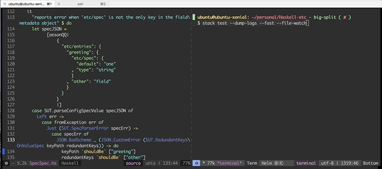
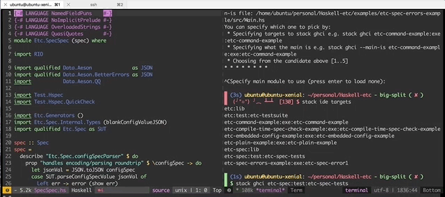
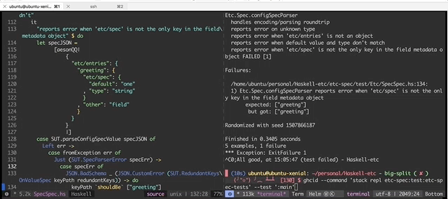
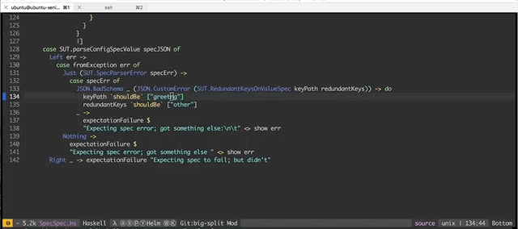
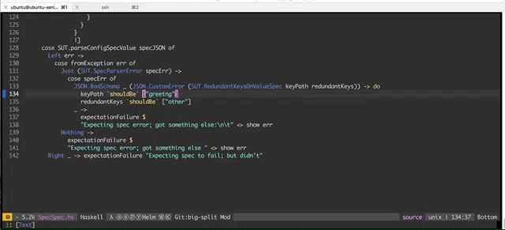


*By Roman Gonzalez, 23 August 2018. Mirrored from FP Complete's blog: [original URL](https://academy.fpblock.com/blog/2018/08/haskell-development-workflows-4-ways/) (offline), [Wayback Machine copy](https://web.archive.org/web/20250624215423/https://academy.fpblock.com/blog/2018/08/haskell-development-workflows-4-ways/).*

One fantastic aspect of Haskell is that it offers various tools that allow different development workflows. In this blog post, we are going to focus on four different workflows to develop Haskell. These are techniques that the FP Complete team themselves use regularly and we wanted to share them with our readers.

## Auto-compile on save via stack `--file-watch`

This workflow is the simplest one you can introduce to your day to day if you are using Stack. To get started you need to use the flag `--file-watch` on the stack command you use to build your project (e.g. `stack build`). This mode monitors all the Haskell files in your project, and it executes the specified stack command as soon as a file change is detected. For example, say you want to run the project’s unit test every time a file changes, you can execute this command in your terminal:

``` bash
$ stack test --dump-logs --fast --file-watch
```

The execution of that command would look something like the following:



**Pros:**

- Very easy to get started with
- Works great for projects with a small number of files
- Detects changes automatically after saving a file
- You can run another command everytime compilation is successful using the `--exec` parameter
- Works with any source code editor

**Cons:**

- Feedback loop is slow when working on a project with many files and dependencies given your workflow goes through compiling and linking sources every time a file changes.
- It doesn’t provide an easy way to interact with in-progress code

## REPL driven development via GHCi

This workflow allows developers to play with Haskell code interactively, in this particular example we are using Stack to run GHCi (as it provides some utilities that load all the source code of the project automatically for us for a particular target), but you can also run it with the `ghci` program. When using GHCi, the result of code changes can be seen quite rapidly, because your toolset doesn’t need to recompile/link the whole project, only the files that changed.

You can run the GHCi REPL in your stack project by executing the following command in your terminal:

``` bash
$ stack repl
```

When using `stack repl`, the workflow looks something like this:



Notice that whenever we change a file, we need to execute the `:reload` command to get the latest changes, and then execute `:main` to run the main application, in this case, the main application is a test-suite so that we can run test-suites from a REPL.

**Pros:**

- Considerably faster feedback loop, especially on larger projects
- Works with any source code editor
- The REPL allows you to run the functions you are developing and interact with them without having to compile a program

**Cons:**

- It doesn’t reload and run your application as soon as you modify a file
- Running the program is not as performant as when you compile the binary

## Auto-reload GHCi REPL with ghcid

[ghcid](https://github.com/ndmitchell/ghcid) is a phenomenal tool developed by Neil Mitchell. This tool is a combination of the first and second approach discussed before. It runs a REPL environment with your application and rapidly reloads (and optionally, runs) your program as soon as you save changes on your source code files. To get started you need to install ghcid and then run a command like the following in your terminal:

``` text
$ ghcid --command "stack repl" --test ":main"
```

When using ghcid, it looks something like the following:



The command above is loading the project’s test target in a REPL environment, and for every change that happens in the file, it executes the `:main` command on its REPL environment.

**Pros:**

- Fastest feedback loop
- Works with any source code
- Allows modifying the test command to run different things on file changes (need to restart the process through)

**Cons:**

- You are no longer able to interact with the source code; it only verifies that the code compiles and it runs the test command
- If running a long-living application on the “test command” argument, it behaves a bit strange (for example, the standard output gets lost)

## Emacs + Intero development

Lastly, we are going to talk about a very powerful workflow. Intero allows you to run the Haskell REPL inside your editor, which in itself allows you to gather information from it to enhance your code editing experience; it also allows you to quickly reload a module you are working on in the REPL with just a key binding. This workflow is very similar to the GHCi one, but with the extra benefit of having the REPL embedded in your editor. If you are an Emacs savvy, you may be able to get all the features that ghcid offers in your emacs editor. Following is an example of how using intero would look like:



With enough experience using emacs lisp, you may extend your editor to support auto-reload and execution of commands like in ghcid. In this example, we create an emacs hook that runs the reload automatically for us as soon as we save the file in the editor:



**Pros:**

- Fastest feedback loop (if you use emacs)
- The REPL allows you to run the functions you are developing and interact with them without having to compile a program
- Seamless integration with emacs (enhances coding experience)

**Cons:**

- Attached to a particular editor

## Conclusion

These are the four main ways we develop Haskell in FP Complete, if you have used one of the approaches but not the others; we encourage you to go out there, to leave the comfort zone and try out a new approach, you may discover it improves your workflow substantially. Do you have another workflow that you are productive with that we didn’t mention? Let us know in the comments.

If you haven't heard about it yet, you can attend our next free webinar on how to deploy Haskell Apps using Kubernetes. You can register for the event by clicking the button below.

Also, if you want to know about Haskell and how we use it at FP Complete, please visit [The Haskell Programming Language](https://web.archive.org/web/2025/https://academy.fpblock.com/haskell).

